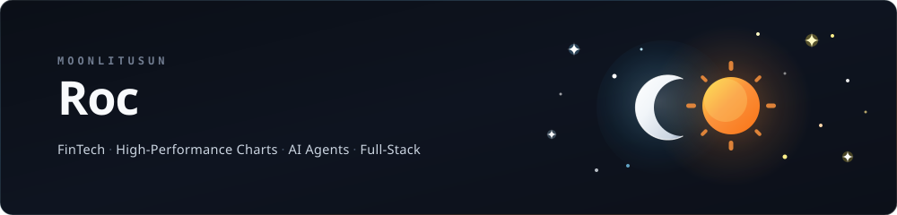

  <a href="https://moonlit.vip"><b>Website ↗</b></a> &nbsp; · &nbsp;
  <a href="https://github.com/moonlitusun"><b>GitHub ↗</b></a> &nbsp; · &nbsp;
  <a href="https://twitter.com/moonlitusun"><b>X ↗</b></a>

 

### Building AI agents, backed by full-stack engineering.

I'm Roc, a **full-stack developer with a frontend focus**, currently building **AI agents and developer tools**.

I like understanding how things work, then building something of my own.

 

## Stack & skills

**AI & agents**

`LLM applications` · `Coding agents` · `LangGraph` · `MCP` · `Skills`

**Languages & frontend**

**Build tools, backend & desktop**

**Also exploring**

 

## Selected work

| 🪐 &nbsp; [Cora ↗](https://github.com/moonlitusun/cora) | ⚡ &nbsp; [ESBoot ↗](https://github.com/esboot-sky/esboot) |
| :--- | :--- |
| **AI coding platform** | **Frontend infrastructure** |
| A workbench connecting local coding sessions with cloud task execution, code review, verification, and delivery. | A shared engineering workflow across Vite, Webpack, and Rspack, with consistent conventions and an extensible plugin system. |
| `Agents` `Desktop & cloud` `MCP & Skills` | `Build systems` `Plugins` `Developer experience` |

 

---

⛅ The sun on the cloud. &nbsp; Always something worth building.

